# ESO Log Tail user guide

A walk through the app, screen by screen, and the reference for every setting. The pictures come from the app itself, drawn over a veteran trial log (`scripts/capture_screenshots.py` regenerates them), so they show what you will see. The [README](../README.md) has the installation steps.

- [First run](#first-run)
- [The main window](#the-main-window)
- [A player's build](#a-players-build)
- [A player's damage](#a-players-damage)
- [A player's damage taken](#a-players-damage-taken)
- [DPS over time](#dps-over-time)
- [Death recaps](#death-recaps)
- [Tracked effects](#tracked-effects)
- [The buff timeline](#the-buff-timeline)
- [Reviewing and copying fights](#reviewing-and-copying-fights)
- [Settings](#settings)
- [Accessibility](#accessibility)
- [The status bar](#the-status-bar)
- [What the numbers are based on](#what-the-numbers-are-based-on)
- [When something looks wrong](#when-something-looks-wrong)
- [Where the app looks for the log](#where-the-app-looks-for-the-log)
- [Migrating from the terminal version](#migrating-from-the-terminal-version)

## First run

1. **Turn on encounter logging in ESO.** The game writes `Encounter.log` only while logging is on, and it is off by default, so there is nothing to show until it is enabled. Logging that was never turned on is the usual reason a first run stays empty.
   - **Recommended: the [Easy Stalking - Encounterlog](https://www.esoui.com/downloads/info2332-EasyStalking-Encounterlog.html) addon** (ESOUI or Minion). It turns logging on and off for you by content type (trials, dungeons, arenas, PvP), shows an on-screen indicator while logging, and adds the `/ezlog` chat command, so you never have to remember.
   - **By hand**: type `/encounterlog` in chat, or enable it under Settings → Combat → Combat Logging, before each run.
2. **Start the app**, before or during play; both work. It looks for `Encounter.log` in the usual ESO folders, including a Documents folder that OneDrive has moved, and picks the most recently written one (see [Where the app looks for the log](#where-the-app-looks-for-the-log)). If there is no log yet, it waits and attaches the moment the file appears.
3. **Check the status bar.** **Last entry** turns green as soon as new lines arrive, so you can confirm logging is on from the app.

Joining mid-raid, the app replays the logging session already in the file: the session's fights load into the history and the whole group, their gear and their bars are known, so you do not start with a half-empty group. The whole session is replayed however long it is, with the progress bar showing how far it has got; a session's worth of trials (500 MB or so) takes about a minute.

## The main window

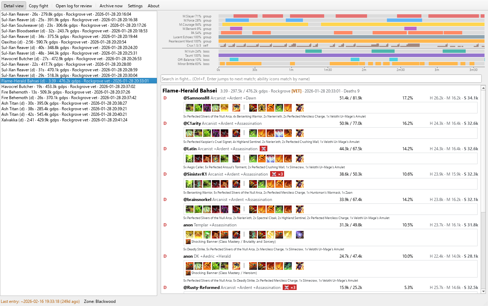

### Fight history

The list on the left has one line per completed fight, `boss · duration · group DPS · time`, grouped by the instance it was fought in. A bold header above each group names the zone and its difficulty, `Sunspire · Veteran`, and neighbouring groups alternate between a plain and a faintly shaded background. A new group starts when you change zone or difficulty, or at the first fight after a completed trial run, even in the same trial; walking back into the instance after a wipe keeps the group. `☠` marks a fight in which a player died, and `ⓘ` a fight with a player whose build has a [possible issue](#possible-build-issues). Hover the `ⓘ` to see who, with their class and the title of each finding, without selecting the fight; with **Hide names** on, the other players' names are hidden there too. A fight appears when combat ends. The newest fight is selected as it ends; select an older fight to read it (following pauses), and select the newest again to follow live fights.

When a fight completes a trial or an arena, a line under it gives the run's result as the game scored it: `✓ Sunspire vet · Vitality 35/36 · 253,117 · 22:31` is the vitality left, the score and the trial's own timer. Vitality is out of 36 in a veteran trial; an arena's maximum is not known, so it shows the points alone. The figure is the game's, not a count of the deaths in the fight pane: the log does not always hold every death the game charged (see [Limitations](#limitations)). A run that fails or is abandoned has no result. The header and result lines cannot be selected; the arrow keys, Home, End and the page keys step over them.

### The fight

- **Trial result**: on the fight that completed a trial or an arena, a strip across the top gives the run's result, the same line as in the fight list. **Copy fight** adds it under the first line.
- **Header**: boss or mob name, then duration, group DPS, zone, start time, and player deaths. In a fight with a boss the DPS reads `boss / total`: the damage dealt to the units the game flags as bosses, then all damage dealt. The duration is the fight time; when the group's dps time (first hit to last, what the DPS divides by) reads differently, it follows in brackets: `1:40 (dps time 1:32)`. The group DPS ends in a small graph line in the link colour: click it, or **DPS graph** on the toolbar, for the [dps over time graph](#dps-over-time).
- **Misfortunes**: in a solo dungeon (March of Sacrifices, Moon Hunter Keep), a line under the header names the Misfortunes the run was started with, `Misfortunes: Warm Welcome · Revoke of Respite · Alleviating Assault`, or reads `Misfortunes: none`; hover a name for what it does. **Copy fight** adds the same line. Other zones have no such line.
- **Buff timeline**: above the header, the [strip](#the-buff-timeline) with one row per effect across the fight, buffs above and debuffs below. A fresh install tracks how much of the fight Major Courage, Major Force, Major Slayer, Powerful Assault, Lucent Echoes and Pearlescent Ward were on anyone in the group; `Taunt:97%`, how long each boss had a taunt on it; seven boss debuffs (Off-Balance, Touch of Z'en, Morag Tong, Minor Brittle, Major Brittle, Elemental Catalyst's weaknesses, Alkosh); and, commented out for an Arcanist to switch on, Crux, the mean and peak Crux you held. Each of these is a [tracked-effect rule](#tracked-effects) and has a row when its effect was up; the group buffs other than Powerful Assault also show at `0%`, in dark red bold, in a group of five or more when nobody had them, and the taunt in any group. In a fight without a boss the boss rules measure the pack and say how many of its mobs they reached: `Alkosh:45% on 7 of 12 mobs`. **Copy fight** puts the same items on one text line.
- **One row per player**, ranked by damage to the bosses and then by all damage (in a fight without a boss, by all damage):
  - the role letter, **T**ank, **H**ealer or **D**PS (see [Roles](#what-the-numbers-are-based-on));
  - the account name, with `*` after the player who dealt the fight's first damage; hover it for the character name and, when the player healed anyone else, their [healing to others](#what-the-numbers-are-based-on); click it for the [build](#a-players-build);
  - the class. A build that borrows skill lines from another class shows those lines after a plus sign, `NB +Aedric +Grave`, read from the character's passives, so a line taken for its passives alone shows too. A pure-class build names its Class Mastery passives after a colon instead, `NB: An Eye for Exploitation, Above and Beyond`. A stock build shows just the class;
  - DPS and the share of the group's damage, each `boss / total` in a fight with a boss (against the units the game flags as bosses, then against everything), and max health, magicka and stamina with the largest pool in bold, then `CPM`, the player's casts per minute: every cast they made in the fight (skills, light and heavy attacks, swaps, dodges, bashes, synergies, potions) over the fight's duration, or over the time they were there for a player who left. The small three-bar mark after a DPS figure says it opens something: click it for the player's [damage window](#a-players-damage); hover it for the time the figure divides by.

DPS includes what a player's pets did: a Necromancer's Blastbones and Skeletal Archer, a Warden's bear, a Sorcerer's atronachs and familiar. A companion is not a pet here: it has [a row of its own](#companions) under its owner. Damage-over-time ticks count, as in Combat Metrics; see [Damage](#what-the-numbers-are-based-on). Each figure divides by its **dps time**, the time from the first of those hits to the last (a second at least) rather than the whole fight, which is also how Combat Metrics works: a player's DPS over the span of their own hits, their boss DPS over the span of their hits on the bosses, the group's over the span of the group's.

### A player's row in detail

With **Detail view** on (the default; Ctrl+D toggles it), each row shows the player's two ability bars as the game's icons, front bar left and back bar right, the ultimate set apart.

- Hover an icon for the ability's name; click it to open the skill on [ESO-Hub](https://eso-hub.com). An ability without a bundled icon shows its name instead.
- An ability the player taunted with in this fight is ringed in purple (or its name is purple).
- A scribed skill is listed under the bars with the two scripts its name does not show, as `Skill (Signature / Affix)`: `Shocking Banner (Class Flourish / Heroism)`. The skill's name already says which grimoire and focus script it is; hover its icon on the bar for all four parts. The skill and the scripts link to their ESO-Hub pages. `(scripts not in log)` means the log does not say which scripts this player uses (see [Limitations](#limitations)); the hover says why, and lists the combinations it can be when the log narrows it down.
- A werewolf gets a third line, **Werewolf**: the bar they fought with in werewolf form and how much of the fight they spent transformed, `in form 100%`. The game never writes that bar into its log, so the app rebuilds it from the werewolf skills the player cast, in the skill line's order; a skill they slotted but never cast cannot show. For a few players the game writes a werewolf bar in place of a human bar instead, and that bar can be stale, so it is left out: such a werewolf may show the Werewolf line alone. At full Fury the game lists Rampage in place of the transformation ultimate for the player writing the log, and the bar shows the morph, Werewolf Berserker or Pack Leader, instead. Hovering either kind of icon says so.
- The line under the bars lists every equipped set with its piece count, `5x Deadly Strike, 2x Zaan, 1x Oakensoul Ring`; each name opens the set's ESO-Hub page.
- A bold, faintly glowing `ⓘ` right after a player's name, beside the `*` of the first damage, means the app found a [possible build issue](#possible-build-issues) in the build they pulled with. Hover it for the list; click it for each finding with the rule behind it. A player without one has no `ⓘ`, in either view.
- A shield outline after the name, in the link colour, opens the player's [damage taken](#a-players-damage-taken): what reached their health over the fight, who did it, and what healed them. Every player has one, died or not, in either view; hover it for the totals. A companion has none.
- After the shares, `p:18199 cd:121%`: the player's estimated effective penetration and critical damage over this fight, from their build and the fight's effects, with the Champion Point rows Settings assumes (see [Penetration and critical damage](#penetration-and-critical-damage)); each second is capped, so a figure at the cap reads as the cap. Hover it for the caps, the shares of them and the share of damage dealt over them; click it for every source. A player who dealt no damage has no token. Shown in both views.

### Companions

A companion that is out during a fight (Mirri, Bastian, Ember, Isobel, Sharp-as-Night, Azandar, Tanlorin, Zerith-var) has a row of its own straight under the player it belongs to, marked `↳` with `C` in the role column and its level where a player's class goes. Its DPS, share and health are its own, and its DPS opens the damage window like a player's. After its health come `CPM`, its casts per minute over the whole fight (its light attacks, blocks, dodges and Break Free count too, so a companion that lay dead for part of the fight, or came out late, reads lower), and `Ult ×2` when it cast its ultimate in the fight: Ember's Raging Storm, Mirri's Impeccable Shot, Isobel's Baneslayer and so on. Hover its name for when it cast it, `Raging Storm cast at 0:07 and 1:38 into the fight`, and for its healing to others. A `☠` after its name means it died in the fight; that is not counted in the fight's Deaths, which are players', and has no recap.

Its name opens a short window with its level, its owner and the companion skills it was seen casting this session: the game writes no bar, gear or perks for a companion into its log, so in Detail view the row's bar is those skills, in the order first cast, with its ultimate set apart at the end. In the window the small number under each skill is how many times the companion cast it in this fight, a dash for none, and **Other** counts its light attacks, bashes, blocks, dodges and Break Free, then every cast and the casts per minute (a companion never heavy attacks, swaps weapons, takes a synergy or drinks a potion). A line under them gives the times of its ultimate and its healing to others. The window ends with the same **Damage dealt** bars a player's build window has (direct against over time, area against single target, Martial against Magical), over the companion's own hits.

By default the owner's figures are their own, as in Combat Metrics, which never counts a companion as the player's. Turn on **Count a companion's damage and healing as its owner's too** under Companions in Settings for the old way: the owner's DPS and share then include the companion's, its abilities show `(pet)` in the owner's damage window, and the shares add up to more than 100%. A companion of a player who has no row has no row either; its damage is still in the group's. A companion whose owner the log never named has no row and is counted nowhere, the group's damage included.

### Players who leave or come back

- A player who leaves the group or the instance during a fight keeps their row in that fight, greyed, with `left · here for 62% of the fight` after the class. From the next pull on they are not listed.
- A player who drops and comes back on the same character in the same zone stays one row. Their DPS divides by the time from their first hit to their last, so the time they were away counts against it, as in Combat Metrics.
- A player who comes back on another character is listed as that character: a new row with the new class and `build not in the log yet` until their next pull, when the game writes their build. That row only shows when the log marks them as grouped with you; the old character's row is greyed as having left.
- An anonymous player (`anon`) who joins your group takes their name.

Their companion goes with them: it stays one row under them when they come back, and leaves the list when they do.

With Detail view off, the rows are one line each, for a quick ranking:

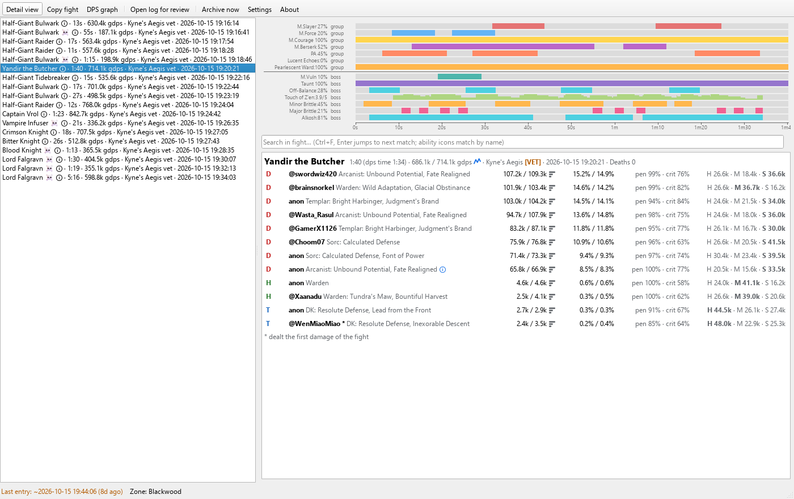

### Possible build issues

The `ⓘ` points out things in a build that are usually mistakes, read from what the log recorded as the fight began (and, for a meal that ran out, during it). Each finding states its rule, so you can judge it yourself; the popup links the set or skill concerned to ESO-Hub. The `ⓘ` after a fight in the fight list sums up the fight: hover it for each flagged player and their findings' titles.

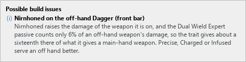

The rules:

- **Nirnhoned on an off-hand weapon.** The trait raises the damage of the weapon it is on, and the Dual Wield Expert passive counts only 6% of an off-hand weapon's damage, so Nirnhoned there is worth about a sixteenth of what it gives in the main hand. A shield's Nirnhoned is the armor trait and is not reported.
- **The same glyph on both weapons of a bar.** Two identical weapon glyphs on one bar share one cooldown, so the second never fires; a different glyph would add a proc of its own. The same glyph on both bars is not reported: a copy on the other bar fills the gap after a swap.
- **Two or more heavy armor pieces on a damage dealer.** Heavy Armor's passives add nothing to damage; one heavy piece is the usual Undaunted Mettle split and is not reported. The rule applies to a player whose role reads DPS and who has not taunted in this logging session, since the role is a heuristic (see [Roles](#what-the-numbers-are-based-on)).
- **A weapon skill on a bar holding another weapon**, a Two Handed skill on a staff bar, say: the skill cannot be cast from that bar, so the slot does nothing. The back bar of a player wearing Oakensoul Ring is not judged, since the ring forbids swapping, and neither is a bar whose weapon the app does not know.
- **Elemental Drain slotted.** The finding states both morphs: Drain applies Major Breach and Minor Magickasteal, Elemental Susceptibility applies Major Breach and the Burning, Chilled and Concussion status effects every 7.5 seconds.
- **Roar of Alkosh, Roaring Opportunist or Huntsman's Warmask worn and never firing.** Alkosh's shockwave needs the wearer to activate a synergy, Roaring Opportunist's Major Slayer a fully charged heavy attack, and the Warmask's Mark of Hircine a bash or a fully charged heavy attack on an enemy. The app counts, over the logging session, the fights of a minute or more the player wore the set in; when the set's effect never came from them in any fight of the session, the finding says how many such fights have passed. One fire anywhere in the session clears it. A Warmask wearer who bashes is not judged: the survey behind the rule found every wearer bashing in nearly every fight, and the mark moving to an add the group meant to kill as often as not.
- **Pearlescent Ward, Xoryn's Masterpiece or Lucent Echoes complete on one bar only.** Their five-piece bonus is a buff for the whole group that holds only while five pieces are active, so the group loses it every time the player swaps bars. A build with no back-bar weapon, or wearing Oakensoul Ring, is not judged.
- **A tank with no taunt or pull.** The player reads as a tank on more than the health pool: a shield, an ice staff or five heavy pieces, and under half an equal share of the group's damage in the fight. Yet neither bar holds a taunt (Puncture and its morphs, Inner Fire and its morphs, Destructive Clench on an ice staff, Runic Jolt and its morphs, a scribed skill with the Taunt focus) or a pull (Chains of Flame and its morphs, Silver Leash, Frozen Gate and its morphs, a scribed skill with the Pull focus), and no taunt of theirs was logged this session. A restoration staff, or more healing than damage, marks a healer, who is not judged.
- **No food or drink at combat start.** Nothing on the player's buff list as the fight began matched the app's list of the game's food and drink effects (the one the build window's Food line uses), so they fought without a consumable's maximum stats or recovery. A meal eaten during the fight is noted with its time. A consumable newer than the bundled list reads the same way; the list is refreshed with the game data.
- **Food that ran out.** The player's food or drink was up as the fight began and faded during it, with nothing eaten before the end. The finding names it and says when. A drink the game logs as several effects counts as gone only when all of them have faded.
- **No Minor Slayer in a veteran trial group.** Minor Slayer is 5% more damage to dungeon, trial and arena monsters. Every trial's sets grant it at three pieces and Oakensoul Ring grants it outright. A damage dealer pulling in a veteran group of five or more with none of them is flagged; a listed set at three pieces on one bar is enough. Healers and tanks are not judged, nor a player who has taunted this session, a normal-difficulty run, or a build the log wrote with no gear.

The rules are fixed in this version; what each finding says is meant to be enough to act on, or to disagree with.

### Finding things in a fight

Type in the search field above the fight (Ctrl+F puts the cursor there). Every match is highlighted and counted, Enter jumps to the next one, Esc clears. Icons match by the ability they stand for, so searching `jabs` lights up every Biting Jabs icon. The search follows you as you switch fights.

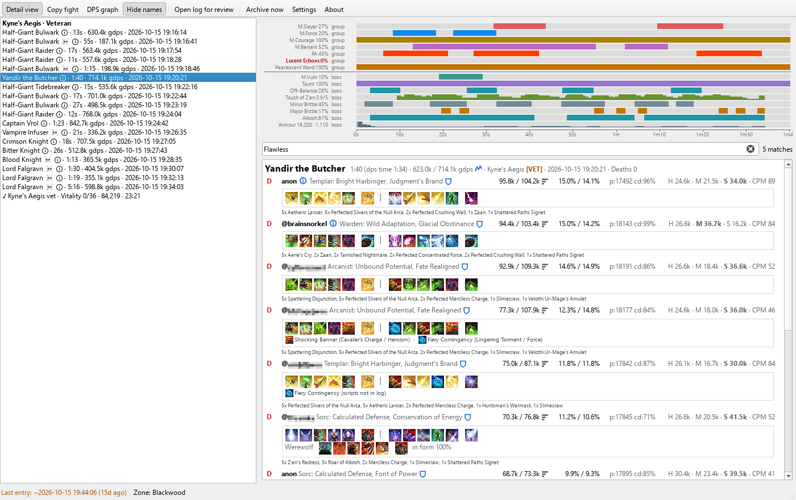

### Keyboard

| Key | Does |
|---|---|
| Tab, Shift+Tab | Move between the fight list, the search field and the fight |
| Up, Down | Pick a fight in the list |
| Ctrl+D | Detail view on or off |
| Ctrl+F | Put the cursor in the search field; Enter jumps to the next match, Esc clears |
| Ctrl+C | Copy fight |
| Ctrl+H | [Hide names](#hiding-other-players-names) on or off, from any of the app's windows |
| Ctrl+= (or Ctrl++), Ctrl+- | [Text size](#settings) a step bigger or smaller, from any of the app's windows; saved |
| Ctrl+0 | Text size back to 100% |
| Ctrl + mouse wheel | Zoom the one page under the pointer until the app closes; the next text size change resets it |

Tab used to toggle Detail view, which kept the focus on the fight list; that is Ctrl+D now.

## A player's build

Click a player's name, in either view, to open their build for that fight. The name carries no mark, unlike the DPS figures; it is underlined while the pointer is over it. The window stays open beside the main window and keeps the fight it was opened for; clicking another name reuses it.

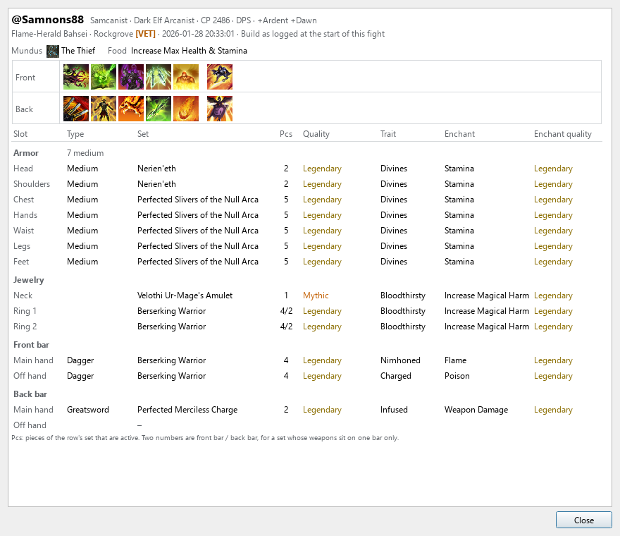

- **Header**: the account name with the character name beside it, then race, class, champion points and role, and the fight.
- **Mundus, food and mastery**: the mundus stone, the food or drink buff the player had as combat started, and the Class Mastery passives a pure-class character has taken. `no known food or drink` means none of their effects is a food or drink the app knows; no mastery part means none has been seen: a subclassed build cannot take one, a mastery that works by a proc shows once it has fired in the session, and Bastion of Light never shows, because the log does not name it. A character takes two masteries; a third beside the class is one the log credited by mistake (Font of Power, now and then).
- **Possible build issues**: the same findings the fight pane's `ⓘ` opens, each with its rule, under the header; nothing there for a build without one.
- **Bars**: front bar above back bar, ultimate set apart, with the same hover names, ESO-Hub links and scribed-skill line as the fight view, and for a werewolf the rebuilt werewolf bar under them. The small number under each skill is how many times the player cast it in the fight, a dash for none. It is the skill's total, so a skill slotted on both bars shows the same number under each. A Destruction Staff skill counts whichever element the staff in hand cast (Elemental Blockade counts Blockade of Frost, Fire and Storms).
- **Other**: the casts no slot holds, as light attacks, heavy attacks, bashes, swaps, dodges, synergies, potions and Break Free, then every cast in the fight and the casts per minute. Synergies are the skills' own (Conduit, Harvest, Feeding Frenzy and the like), not a trial's mechanics. Casts start counting at the pull, as Combat Metrics counts them, so pre-buffs are left out.
- **Gear**: one row per slot under Armor, Jewelry, Front bar and Back bar, with the set (a link to its ESO-Hub page), quality, trait, enchant and the enchant's quality. A slot with nothing logged shows a dash, a mythic piece is marked Mythic, and a slotted poison gets a row under its bar.
- **Type** is the armor weight, or what a weapon is: `Inferno Staff`, `Dagger`, `Greatsword`, `Shield` and so on. The Armor heading counts the pieces of each weight, `5 medium, 1 light, 1 heavy`. A dash means the app does not know the piece (see [Limitations](#limitations)).
- **Pcs** is the number of pieces of the row's set that are active, counted per weapon bar: armor and jewelry count on both bars, and each bar adds its own weapons, a two-handed one as two. `5` means five on either bar. `5/3` means five on the front bar and three on the back: that set's five-piece bonus is live on the front bar only.
- **Damage dealt**: the kinds of the player's damage in the fight, the same three bars as the [death recap](#death-recaps) draws for damage taken: direct against over time (Master-at-Arms, Thaumaturge), area against single target (Biting Aura, Deadly Aim), Martial against Magical (Mighty, War Mage), with the damage types under them and what enemy shields absorbed named apart. For a player's own skills the area side comes from the casts (a cast that struck two or more units) and, against a lone boss where every cast strikes one unit, from UESP's skill table (Impulse is an area skill, Crystal Fragments single target); a line under the bars says how much of the damage the table classed. A side's label links to its star on ESO-Hub and names it on hover.
- **Penetration** and **Critical damage**: where the player's figures come from and how they stand against the caps, see below. Each ends with its *Effective* figure in a framed row, the line that counts, when the player dealt damage.
- **Resources**, last: the magicka, stamina and ultimate the player spent and gained in the fight, each with its rate per second, see [Resources](#resources) below.

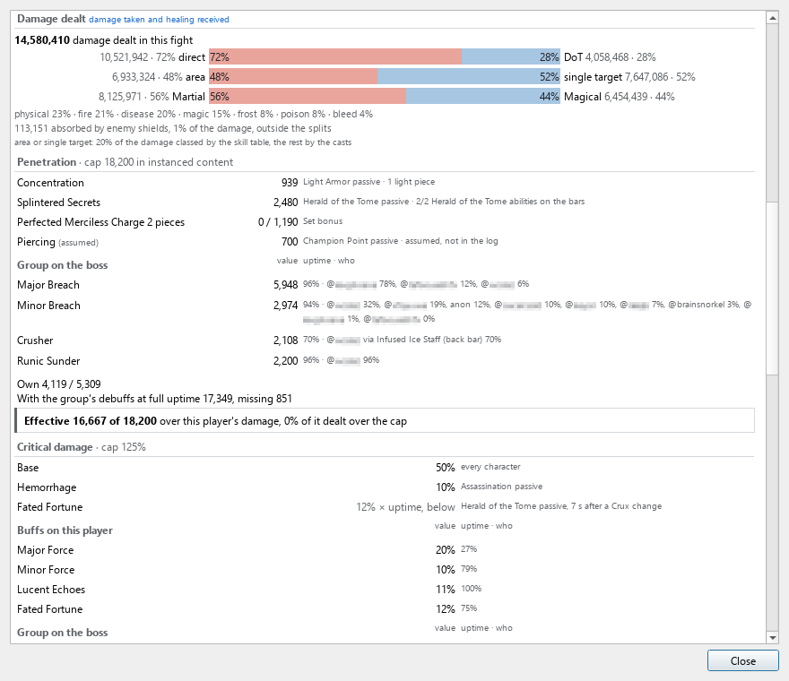

### Penetration and critical damage

Under the Damage dealt section, two sections do what raid leads do with a spreadsheet of checkboxes: list every source of Offensive Penetration and of Critical Damage with its value, add them up, and compare the sum with the cap (18,200 penetration against the bosses and mobs of dungeons, trials and arenas, 9,100 overland, 27,300 against a solo dungeon's bosses; 125% critical damage, 155% with the Nightblade mastery Above and Beyond). Every row traces to something the log said, except the rows marked *assumed*.

A solo dungeon is known by its zone id: the log gives it the group dungeon's name and no difficulty, which would otherwise read as overland. Its trash has an instance's 18,200, its bosses 27,300 and its final boss 36,400, and the game caps an enemy's armour at 25,000, so against a boss the first 2,300 of penetration changes nothing until the group's debuffs bring the armour under the cap. The app takes every boss at 27,300 and says so where the figure appears. Both solo dungeons, March of Sacrifices and Moon Hunter Keep, are known. The Misfortunes picked at the door raise the enemies' health and damage, not their armour, so the figures hold whichever are on.

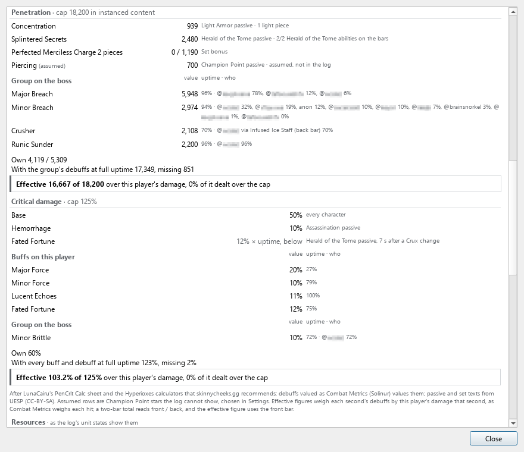

- **The player's own rows**: the passives on their build (light armor's Concentration per piece, medium armor's Dexterity, Hemorrhage, Piercing Spear, Fated Fortune, Advanced Species and Splintered Secrets per slotted ability, Dismember, the Khajiit and Wood Elf racials, Twin Blade and Blunt and Heavy Weapons per axe or mace, Blessing at the Peak, Above and Beyond), the mundus stone with its Divines pieces, each set at its worn piece count (`Spriggan's Thorns 5 pieces 3,460`, Velothi's 1,650, Order's Wrath's 8%), and a Sharpened weapon. A value that depends on the bar reads `front / back`. A bonus the game grants under a condition (Sul-Xan's 12% after a soul, Dismember while a Grave Lord ability is active) is listed as `up to` and not added; a set that gives Minor Force at all times is listed as the reason for the buff, which is measured instead.
- **Assumed rows** are Champion Point stars, which the log never carries when they only change a stat. Settings chooses them: Piercing (700) and, in solo and small-group fights (up to four players), Fighting Finesse (8%) by default, since a trial build's Warfare slots usually go elsewhere; Backstabber (10%) and Force of Nature off. Force of Nature's row, when on, is its per-effect value times the status effects actually measured on the boss.
- **Group on the boss**: each debuff that was on the boss during the fight with its value, its uptime and who applied it (`@tank via Infused Inferno Staff (back bar) 70%`, `@healer via Roar of Alkosh 100%`): Major and Minor Breach, Crusher (1,622 for the gold glyph, 2,108 Infused, 3,056 with Torug's Pact, read from the caster's weapon), Roar of Alkosh, Crimson Oath's Rive, Runic Sunder, Crystal Weapon, Tremorscale; Minor and Major Brittle and Elemental Catalyst's weaknesses for critical damage. In a fight without a boss the debuffs on the mobs the group hit are measured.
- **Buffs on this player**: Major Force, Minor Force, Lucent Echoes and Fated Fortune's proc, with their uptime on this player.
- **Totals**: *Own* is the player's rows and the assumed ones; *with the group's debuffs at full uptime* adds every debuff seen, the way the spreadsheet does with ticked boxes, and says how far over or under the cap that is; *Effective* is the figure that counts: for every second of the fight, the debuffs on the target and the buffs on the player are added to the player's own, capped, and weighed by the damage this player dealt that second, which is how Combat Metrics weighs each hit. Beside it, the share of the player's damage dealt while over the cap. It sits in a framed row with a bar at its left edge, so the conclusion stands out from the two lines of working above it. A player who dealt no damage gets no effective figure.

The values follow LunaCairu's PenCrit Calc sheet and the calculators at hyperioxes.com that skinnycheeks.gg recommends; the debuffs are valued as Combat Metrics values them; the passive and set texts come from UESP. The sections are not a damage simulation: resistances the game applies that no debuff names, and penetration from procs the log does not carry, are not in them.

### Resources

At the end of the window, after the penetration and critical damage sections, the Resources section answers whether the player's sustain held: what they spent their magicka, stamina and ultimate on, where it came back from, and what came in over cap. Every group member's pools are in the log, not only yours, so it works for anyone in the fight.

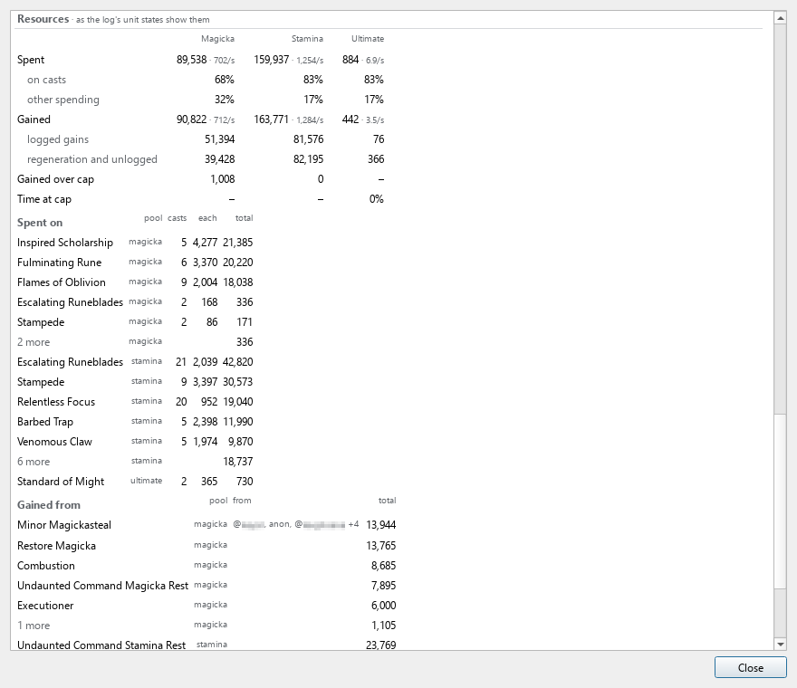

- **Spent**, with the rate per second: what the player's pools fell by. **On casts** is the part that fell at the moment of a cast, the cast's cost; **other spending** is the rest, blocking, sprinting and the costs the game writes later, which leave no line of their own. Light and heavy attacks and weapon swaps cost nothing and are never charged.
- **Gained**, with the rate per second: what the pools rose by. **Logged gains** are the ones the log names (Undaunted Command, Bountiful Harvest, a potion); **regeneration and unlogged** is every other rise: base regeneration, the ultimate every player generates, and anything else the game does not write down. It is what is left over, not a measurement of regeneration.
- **Gained over cap**: logged gains that arrived while the pool was already full.
- **Time at cap** for ultimate: the share of the fight the player sat on a full ultimate bar. The game never logs ultimate gained at cap, so this stands in for ultimate gained over cap.
- **Spent on** lists the casts the most went on, five per pool, with the casts that cost something, the average cost and the total. **Gained from** lists the five largest gains per pool, with the players who gave it when that was another group member (a healer's Bountiful Harvest, a Pillager's Profit), the three who gave most named. With [Hide names](#hiding-other-players-names) on, those names are hidden too.

The figures come from the pools' rises and falls between one logged state and the next, which the log writes about ten times a second for each player, so a cost and a gain inside the same tenth of a second cancel out. Read them as a fair picture of the fight, not as tooltip costs.

## A player's damage

Click a player's DPS figure, the one with the small three-bar mark after it, to open their damage for that fight. The window stays open beside the main window and keeps the fight it was opened for; clicking another figure reuses it.

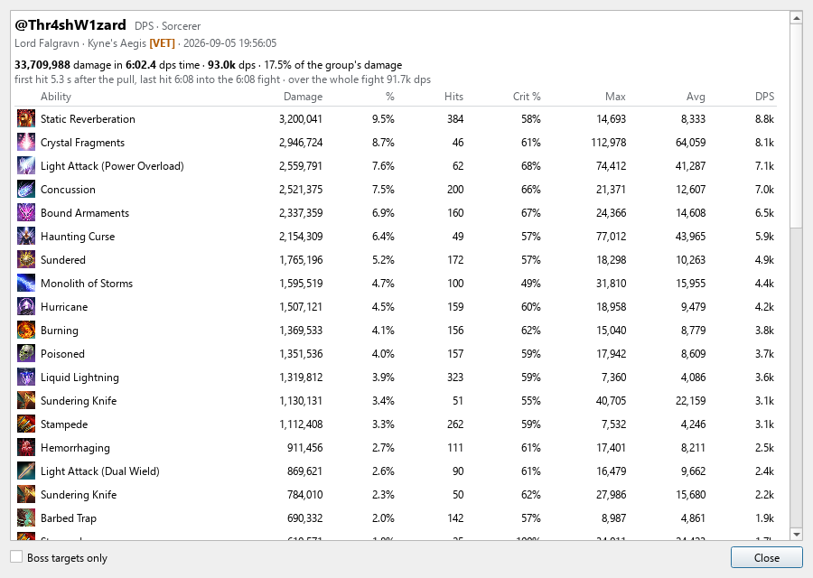

- **Header**: the player, then the fight, then the total: the damage dealt, the dps time it was dealt in, the DPS, and the player's share of the group's damage. Under it, where the first and last hits fell in the fight, and what the DPS would read over the whole fight.
- **Abilities**: one row per ability, largest damage first, with its icon: damage, share of the player's damage, hits, critical rate, largest hit, average hit, and DPS (that ability's damage over the player's dps time). A pet's ability says `(pet)`. A shield's absorb counts as damage, not as a hit.
- **Targets**: each unit the player hit, with the damage, its share, the hits, the span from the player's first hit on it to their last, and the DPS over that span (what Combat Metrics calls the real DPS to that target). Bosses are marked.
- **Boss targets only**: in a fight with a boss, the switch at the bottom narrows every figure to the units the game flags as bosses.

## A player's damage taken

Click the shield after a player's name, in either view, for everything that reached that player's health over the fight and everything that healed them. Every player has one, died or not: the [death recap](#death-recaps) is for a player who died and keeps the last seconds before each death, and its **Damage taken this fight** block links here, as the **Damage dealt** heading of the [build window](#a-players-build) does. The window stays open beside the main window and keeps the fight it was opened for; clicking another shield reuses it.

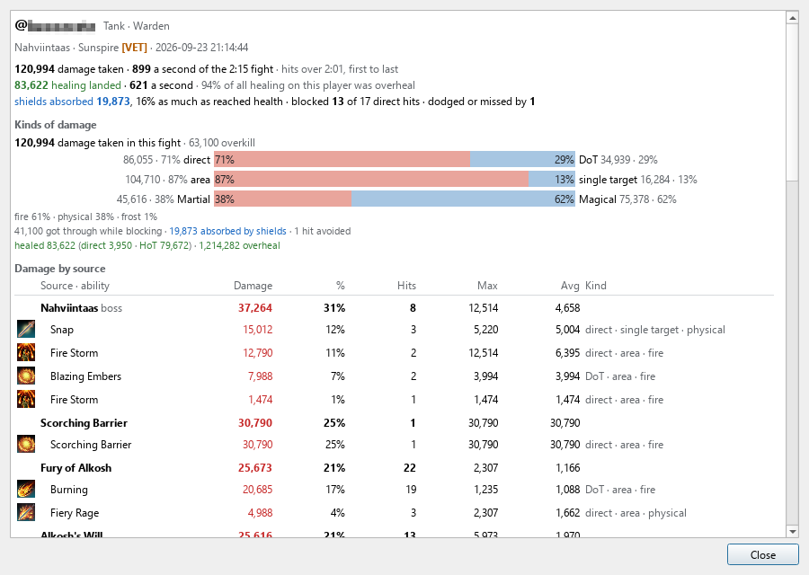

- **Header**: the player, then the fight, then the figures: the damage taken and the rate per second of the fight, pull to end (not the dps time: a quiet stretch is part of the answer, and two pulls compare); how long the hits spanned; the healing received, its rate, and the share of all healing on the player that was overheal; what damage shields absorbed, as a share of the damage that reached health; how many of the direct hits were blocked; and the hits dodged or missed. What a block, armour or resistances prevented is not in the log, so it is never stated.
- **Kinds of damage**: the bars and lines the [death recap](#death-recaps) draws, over the whole fight.
- **Damage by source**: every unit that hurt the player, bosses first (marked `boss`), then by damage. Several units of one name are one row with their count, `Alkosh's Will ×4`; damage the log credits to no unit (fall damage, some set procs) is the `No unit named in the log` row. Under each unit, its abilities largest first, with the damage, its share of all the damage taken, hits, largest hit, average hit, and the kind words the recap uses, `direct · area · fire`.
- **Healing received**: every unit that healed the player, by the healing the player received from it, with the player's own heals marked `own` and a pet's heals (a Twilight Matriarch's) in a row of their own, named after the owner and marked `pet`. Under each healer, their abilities. **Overheal** is the share of that row's healing that overflowed, not an amount: in a trial about nine tenths of all healing on a player is overheal, so the amounts would bury the healing received; a row near 100% is a HoT ticking on a full bar. **Kind** says `HoT`, `direct`, or the mix.

With **Hide names** on, other players are masked here as everywhere, as sources and as healers. A fight recorded by an older version says `Damage kinds were not recorded for this fight`; one recorded before the window had its by-source and by-healer tables says so under those headings.

## DPS over time

Click the group DPS figure in the fight header, the one ending in a small graph line, or **DPS graph** on the toolbar, for a graph of the fight: the group's dps and each player's across the fight, drawn the way Combat Metrics' graph tab draws them. The group has the upper panel and the players the lower, each on its own scale (the group's figure is as many times a player's as there are players), sharing the time axis.

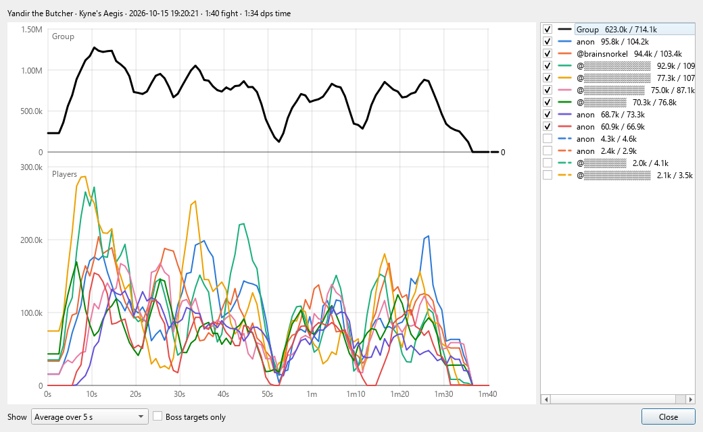

- **Show** picks the curve: the average over a window of 1, 5 (the default, as in Combat Metrics), 10 or 30 seconds, or the running figure, which is the live dps as it stood at each second and ends at the fight's dps.
- **Legend**: tick the group and the players to draw. The first eight players are on to begin with, and a player past the eighth draws dashed in a reused colour, since eight is as many colours as can be told apart. With *Colour-blind colours and line styles in the DPS graph* on (Settings → Display), the lines take seven colours chosen to stay apart for red-green and blue-yellow colour blindness, and each player in turn is drawn solid, dashed, dotted or dash-dotted, so no two of the first 28 players look alike. Each entry shows the player's dps (`boss / total` in a fight with a boss). The choices are kept from one fight to the next while the window is open.
- **Hover** the chart for a crosshair with every drawn line's value at that second; with four lines or fewer, each line's end value is labelled.
- **Boss targets only** narrows every line to the damage on the units the game flags as bosses.

## Death recaps

A player who died has a red skull (**☠**) on their row, `☠ ×2` for two deaths. Hover it for when and to what they died; click it for the recap window, which stays open beside the fight view.

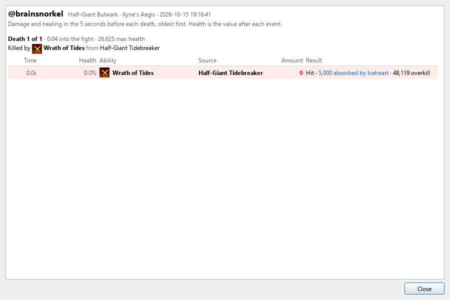

The window opens with the deaths. Each names the killing ability and who used it, lists the last seconds of damage and healing, oldest first (5 seconds by default, up to 10 in [Settings](#settings)), and sums those seconds by kind under the table. **Damage taken this fight** closes the window: everything that reached the player's health over the whole fight, summed the same way, then the abilities that did most of it; the link beside its title opens the player's [damage taken window](#a-players-damage-taken), which has every ability, the units that did the damage and the healers.

The kinds are the splits the Warfare champion point stars act on, each a two-colour bar with the amounts and percentages on either side:

- **direct** against **DoT** (damage over time): a hit or a tick (Ironclad and Enduring Resolve reduce them for damage taken).
- **area** against **single target** (Unassailable and Duelist's Rebuff). The log does not say whether an attack was an area attack, so the app reads the cast: a cast that struck two or more players in the fight is area, and the row says `area · hit 8 players`. An ability that struck a group earlier in the session reads as area on a lone hit too; a cast that struck one player, of an ability never seen on two, reads as single target.
- **Martial** against **Magical** (Hardy and Elemental Aegis): physical, bleed, poison and disease damage on one side; magic, fire, frost and shock on the other. Under the bar, the damage types behind them, `fire 64% · physical 19% · frost 17%`. Oblivion damage, fall damage and drowning belong to neither and are named apart.

Under the bars: what got through while blocking (the log writes what a block let through, never what it saved), what damage shields absorbed, hits dodged or missed, the healing received against the overheal (direct heals and HoTs apart: Focused Mending and Swift Renewal), and the killing blow's overkill. Each side's label links to the first star's ESO-Hub page, and hovering it names every Warfare star for that side with the game's text. The app never knows which stars a player has: the log does not carry them.

The event table:

- **Time** before the death, and the player's **health** after the event (with its share of max health).
- The **ability**, with the game's icon, and its **source**: the monster or player that hit or healed.
- The **amount** that reached or restored health, and the **result**: hit, critical hit, DoT, blocked, dodged, missed, fall damage, heal, or HoT, with the damage type after it (`Hit · fire`) and `area · hit N players` for an area hit. A hit soaked by a damage shield says how much was absorbed and by which shield, a heal eaten by a healing-absorb effect is listed as such, and the killing blow shows its overkill.

Heals that were pure overheal are left out of the table and counted in the overheal figure. A death the game writes just after combat ends (the last player standing in a wipe) still counts and is added to that fight. A fight recorded by an older version says `Damage kinds were not recorded for this fight` where the summaries would be.

## Tracked effects

Every row of the buff timeline is a rule in Settings → **Tracked effects**, one per line, the group buffs and the taunt included. The rules are plain text: copy them to a friend, or paste theirs in. A fresh install starts with these:

```
Major Courage    = 109966 on group expected large
Major Force      = 61747 on group expected large
Major Slayer     = 93109 on group expected large
Powerful Assault = 61771 on group
Lucent Echoes    = 220015 on group expected large
Pearlescent Ward = 172621 on group expected large
Taunt            = 38254 on boss each expected small large
Off-Balance   = 45902 62988 39077 34733 20806 130139 130145 130129 125750 62968 25256 34737 23808 137257 45834 137312 131562 on boss
Touch of Z'en = 126597 on boss dots
Morag Tong    = 34384 on boss
Minor Brittle = 145975 on boss
Major Brittle = 263825 on boss
Elemental Catalyst = 142610 142652 142653 on boss
Alkosh        = 76667 on boss
# Your own Crux, for an Arcanist: take the # off to track it
# Crux          = 184220 on self stacks
```

A rule is `Name = ability ids on <scope>`, then optionally a measure (`stacks`, `each` or `dots`) and `expected <sizes>`, in any order:

- **Ids**: a rule matches any of its ids, since an effect such as Off-Balance has one id per skill that applies it. They are the ids the game logs; an addon such as HyperTools or LuiExtended shows them.
- **Scope** says whose effects count: `self` is the player whose client writes the log, `group` any group member, `pets` a group member's pet, `boss` an enemy the game flags as a boss, `enemies` any hostile.
- **Measure**: by default, the share of the fight the effect was on at least one unit of the scope, `Off-Balance:17%`. `stacks` gives the mean stack count while it was up and the peak, `Crux:2.1/3`. `each` measures every unit of the scope separately, over the time that unit was alive in the fight, and shows the mean. That is the taunt's measure: a fight with two bosses averages them, and a boss killed early is measured to its death.
- **`dots`** is for Touch of Z'en, whose stacks the game never writes to the log: while a wearer's Z'en is on the boss, it counts that wearer's damage-over-time effects on it, at most five, and shows the mean and peak, `Touch of Z'en:4.3/5`. This is how Combat Metrics counts it. An effect counts when the log shows it ticking as damage over time, so Burning, Poisoned, bleeds and set DoTs count, a ground area such as Stampede does not, and 0 means Z'en was up with no bonus.
- **When a rule shows**: a rule's row, and its item in the copied text, shows whenever its effect was up in the fight. `expected` makes it show at `0%` even when the effect never came, with its label in dark red and bold, in the group sizes you name: `solo` (one player), `small` (two to four), `large` (five or more), or `all`; `expected` alone means all. The defaults expect five of the six group buffs in a large group and the taunt in small and large groups, so a missing Major Courage in a trial stands out in red, while a dungeon run is not a column of zeros. Powerful Assault is not expected: the set's buff is usual in a trial, but nobody has to bring it, so its row appears only when someone had it. The boss debuffs show when someone applied them.
- **Trash packs**: in a fight without a boss, a `boss` rule measures every hostile the group fought instead, and both it and an `enemies` rule say how many of the pack's mobs the effect reached: `Alkosh:45% on 7 of 12 mobs`. In a boss fight nothing changes.
- **HyperTools**: a line that starts with `$` is a tracker exported from the [HyperTools](https://github.com/Hyperioxes/HyperTools) addon, pasted as is. Its name, ability ids and target become a rule; `stacks`, `on boss` or `expected <sizes>` after the string apply to it.

Rules saved by an earlier version are brought up to date once, when the app starts: the default group-buff and taunt lines get their `expected` words, a `Touch of Z'en … stacks` line becomes `dots`, and a Powerful Assault line reading `expected large` loses those words again. A line you renamed, or gave your own `expected` sizes, is left as you wrote it.

Delete the lines you do not want and rename the rest as you like (`MCourage` if you prefer the short form). The box tells you how many rules it holds and which lines it cannot read. **Examples…** opens a list of example rules, each with what it tells you and its line, the default rules first: tick the ones you want and **Add to rules** puts them under yours, or **Copy** puts the ticked lines on the clipboard to share. A rule you already have starts unticked.

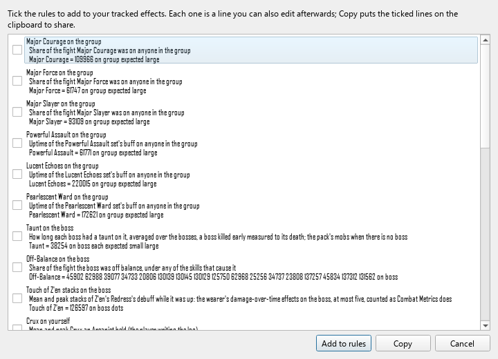

Saving restarts monitoring, so new rules apply to the session's fights at once.

## The buff timeline

A compact strip above each fight shows every tracked effect across the fight's length (see the [main window picture](#the-main-window)).

- **Rows**: the strip's built-in rows, Major Slayer, Major Force, Major Courage, Major Berserk, Powerful Assault, Major Vulnerability and Taunt, then one row for each of your [tracked-effect rules](#tracked-effects) (a rule with the same name as a built-in row does not get a second one). Major Berserk and Major Vulnerability are built-in rows only; they are not in the copied text line. A rule whose effect never occurred has a row only when it is [expected](#tracked-effects) in a group of that size, an empty one reading `0%` with its label in dark red and bold (a lighter red on the dark theme); otherwise it is left out, and the strip disappears when there is nothing to show.
- **Buffs above, debuffs below**: rows whose effect is on your side (`group`, `self`, `pets`) come first, then the rows on the enemy (`boss`, `enemies`, `mobs`), with a thin line between the two. Each side keeps the order its rows come in: built-in rows first, then your rules in the order you wrote them.
- **Each row** is filled where the effect was up, with its uptime in the label and time ticks underneath. Beside the label a word says whose effect it is: `group`, `boss` for Major Vulnerability and the taunt, and each rule's scope (`self`, `pets`, `enemies`, or `mobs` for a boss rule measured on the pack of a fight without a boss). A stacking rule's bar rises and falls with the count, and Touch of Z'en's against its five DoTs. A group buff that reached only one or two people is cross-hatched rather than solid: the span is unbroken, so it still reads as up, and the hatch says it was not on the whole group (clicking the row says how many it reached).
- **Armour**, the last row, is not an effect but an estimate: the target's armour (18,200 for the bosses and mobs of dungeons, trials and arenas, 9,100 overland, 27,300 for a solo dungeon's bosses) less the group's armour debuffs on it, second by second, over the time the group was hitting that target. The bar is full while nothing is on the boss and drops as Major and Minor Breach, Crusher, Roar of Alkosh and the rest are applied, so what is left is what each player's own penetration has to cover. Before the first hit on the target, after the last, and through a gap of more than five seconds between hits (a dragon in the air) the row is blank, since there was nothing to debuff: on a Xoryn pull, where the combat starts at the Defense Prisms and reaches Xoryn some seven minutes in, the row begins when he is engaged, and hovering the blank says so. The label gives the estimate and the armour left averaged over the drawn time; hover the bar for the figure at that moment and the debuffs behind it, hover the label for where the estimate comes from, click for the average, the lowest point, how much of that time had no armour debuff at all, the window when it is not the whole fight, and the same remainder weighed by the damage dealt, which is how the build window's effective figures read. On a solo dungeon's boss a dashed line marks the game's 25,000 cap on an enemy's armour: above it nothing counts until the debuffs bring the armour under, and the final boss, at 36,400, has more than the row assumes. The row follows the penetration cap in Settings when it is set to a number. The row is drawn on the target the group damaged most (the mobs of a trash fight at an instance's 18,200, and among a pack's equal mobs the one fought longest; a boss that returns as a new unit, as Nahviintaas does at each landing, keeps one row), and only on fights recorded since 0.14.0; a fight recorded before the window was added is drawn over the whole fight as it was.
- **Hover** a segment for who cast it and who received it at that moment. Hover a label for its full text when it is cut short.
- **Click** a row, label or bar, for a summary of the whole fight: who applied the effect (each caster's uptime, how much of it no other caster covered, and how many spans), who had it (each receiver's uptime, and for a stacking rule its peak and the time at the peak), and, when there are only a few of each, a grid of caster against receiver. A click elsewhere or Esc closes it.

## Reviewing and copying fights

**Open log for review** loads any log file, a split file, a zipped split or an `Encounter-*.zip` archive, and lists its fights while live monitoring carries on underneath. A zip is read as it stands, never unpacked to disk; if it holds more than one log, the app asks which. A review reads its file on a thread of its own, so live fights keep arriving while it loads; **Cancel review** beside the progress bar stops it. A log over 1 GB (an old month-long `Encounter.log`, say) is looked through first, which takes a few seconds per GB, and the app offers the whole log or only its last few sessions, with the time each takes: reading a 4.7 GB log takes about 8 minutes, its last three sessions about one. The cut is always at the start of a session, so the fights shown are exactly what the whole log gives for them. A banner shows which file is open; **Back to live** returns to the live session.

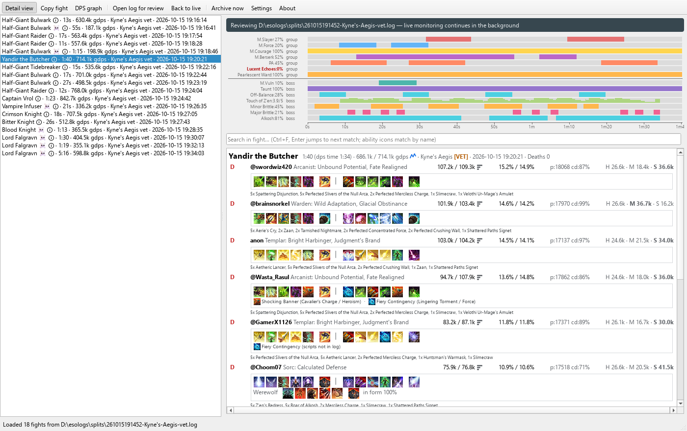

**Copy fight** (Ctrl+C) puts the selected fight on the clipboard as plain text, names rather than icons, ready for Discord: the header, the tracked effects on one line (`Major Courage:87% … Alkosh:45%`), each player with their dps, shares, effective penetration and critical damage (`— 61.8k / 63.0k (12.4% / 12.1%) · p:18141 cd:119%`), their bars, sets and scribed skills (`Leashing Soul (Druid's Resurgence / Cowardice)`), and for anyone who taunted, what with: `taunted with Inner Rage ×262, Inner Fire ×11`. With [Hide names](#hiding-other-players-names) on, the copy carries `@▒▒▒▒▒▒` in place of every name but yours.

**About** shows the version, the project link and the credits.

## Hiding other players' names

For a screenshot or a pasted fight that should give away nobody else's identity, turn on **Hide names** on the toolbar (Ctrl+H toggles it; the same box is under Privacy in Settings). Every player but you keeps their row and their figures and loses their handle and character name: in the fight pane and in the build, damage and death-recap windows the name becomes a pixelated word with its `@` left readable, so it still reads as a handle; in hover text, pop-ups, the DPS graph's legend, window titles and the copied fight it reads as `@▒▒▒▒▒▒`. Enemy, pet, set and ability names stay. The switch is saved, and the pressed button shows it is on.

- **Who stays visible** is the player whose game wrote the log, which the log itself says. Reviewing a file a friend logged keeps the friend's name and hides yours.
- **The pixelated word is not the name blurred.** Blurred or pixelated text can be read back when the font is known, so the app draws a made-up word of the same length and pixelates that; the picture carries nothing of the name but its length.
- The in-fight search cannot find a hidden name. Hovering one shows blocks, and a click still opens the build.

The pictures in this guide are taken with the switch on.

## Settings

Open **Settings…** from the toolbar.

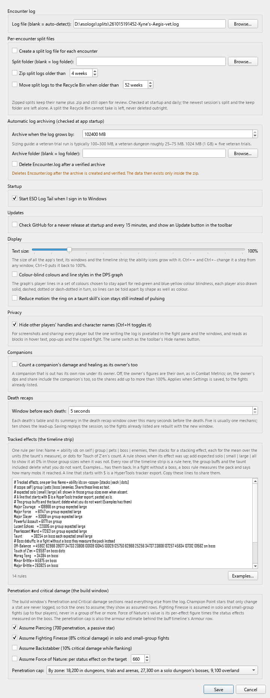

- **Encounter log**: a specific `Encounter.log`, or blank to auto-detect.
- **Per-encounter split files**: write each encounter to its own `YYMMDDHHMMSS-{Zone-Name}{-vet}.log` in a folder of your choice (blank uses the log's folder). They are handy for review, and small enough to share. *Zip split logs older than N weeks* and *Move split logs to the Recycle Bin when older than M weeks* (both off by default) keep the folder in check: see [Old split logs](#old-split-logs). One file per logging session: a session the app meets again (starting mid-session, saving Settings, a restart or a crash) is continued in the file it already has, never written again under a `-1`; a file cut short gets its missing end, a complete one is left as it is. Only one running copy of the app writes into a folder: a second one finds the first's lock file there (`.esolog-tail-split.lock`) and says so in the status bar instead of splitting. Copies that an older version left behind (`-1`, `-2`, … files identical to their neighbour) can be moved to the Recycle Bin with `python scripts/dedupe_splits.py --recycle` from a source checkout.
- **Automatic log archiving**: the growth threshold that triggers an archive at startup, the archive folder, and whether to delete the original after a verified archive. See [below](#automatic-log-archiving).
- **Startup**: *Start ESO Log Tail when I sign in to Windows*, a per-user login entry that needs no admin rights and is removed on uninstall. Not offered on Linux.
- **Updates**: check GitHub for a newer release at startup and every 15 minutes, and show an **Update** button in the toolbar when one exists; the *Channel* is **Stable** (the default) or **Beta**. See [below](#automatic-updates).
- **Display**: *Text size*, 80% to 200% of the system's text in steps of 10, for the whole app: the fight list, the pages, every window, Settings and the timeline strip, whose rows and labels grow with it. Ability icons grow above 100% and never shrink below it. Ctrl+=, Ctrl+- and Ctrl+0 change it without opening Settings. It applies as soon as Settings is saved; no replay is needed for it. *Colour-blind colours and line styles in the DPS graph* (off by default) swaps the graph's colours for a set measured to stay apart for colour-blind readers, and gives each line a stroke of its own as well; see [DPS over time](#dps-over-time). *Reduce motion* keeps the ring on a taunt skill's icon still instead of pulsing.
- **Privacy**: hide other players' handles and character names, the same switch as the toolbar's **Hide names** button and Ctrl+H. See [Hiding other players' names](#hiding-other-players-names).
- **Companions**: also count a companion's damage and healing as its owner's (off by default). Saving replays the session, so the fights already listed change too. See [Companions](#companions).
- **Death recaps**: how many seconds before each death the recap keeps, 5 to 10 (5 by default). Saving replays the session, so the fights already listed are rebuilt with the new window. See [Death recaps](#death-recaps).
- **Tracked effects**: the rules behind the timeline strip. See [Tracked effects](#tracked-effects).
- **Penetration and critical damage**: the Champion Point stars the build window's sections assume (Piercing on by default; Fighting Finesse on by default in solo and small-group fights and never in a group of five or more; Backstabber and Force of Nature off, with Force of Nature's figure per status effect), and the penetration cap: by zone, or always 18,200 or 9,100. These apply to the next build window opened; no restart is needed. See [Penetration and critical damage](#penetration-and-critical-damage).

Saving restarts monitoring: the history clears and the current session is replayed with the new settings. Settings live in a per-user file, `%LOCALAPPDATA%\esolog-tail\config.json` (`~/.config/esolog-tail/config.json` on Linux), and survive upgrades and uninstalls.

### Automatic updates

The app checks GitHub for a newer release a few seconds after it starts and every 15 minutes after that, so a release published during a raid night is noticed before the next one. Nothing pops up: when a newer release exists, an **Update to 0.15.0** button appears at the right end of the toolbar with an **ⓘ** beside it, and the window title ends with "0.15.0 available". The check costs nothing while nothing has changed (it asks GitHub only whether the release is still the one it last saw) and never delays the fight pane.


- **The button**: on Windows one click downloads the installer (progress in the status bar), then hands over to it and closes the app; your settings are kept and the app comes back when the installer finishes. Nothing is downloaded or installed until you click, so leave it until the pull is over. On Linux the button reads **Get 0.15.0** and opens the release page for you to download the new tarball.
- **The ⓘ**: hover for the version and its date; click for the release notes, with links to the release page, the changelog and **Changes since** your version (every change between the two, however many releases lie between), and **Don't show this version again**, which hides the offer until a later release. Saving Settings with the check on shows a skipped version again.
- **The channel** (Settings → Updates): **Stable**, the default, offers a release once it has been used in real fights for a while with nothing found. **Beta** offers every release as soon as it is published, and the window title says `· beta` so a screenshot shows which you run; About names the channel too. Moving from Beta back to Stable never takes you back a version: you keep the one you have until a Stable release is newer, and an offer Beta made goes as soon as you save.

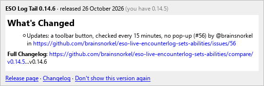

If a download fails, the button comes back and the status bar says why.

### Automatic log archiving

ESO never truncates `Encounter.log`. With regular raiding it grows by hundreds of MB a night and can reach tens of GB. The app archives it for you.

- **When**: checked **once, at app startup**. ESO keeps the log open for the whole game session (even between `/encounterlog` toggles), so startup, usually before you launch ESO, is the safe moment.
- **Trigger**: the log has grown by more than the threshold since the last archive. The default is **1024 MB**, about five veteran trials (a vet trial run is typically 100 to 300 MB, a vet dungeon roughly 25 to 75 MB).
- **What it does**: streams the log into `Encounter-YYMMDDHHMMSS.zip` (stamped from the newest log entry) in the archive folder, by default next to the log, with progress in the status bar. The zip is written as a `.partial` file and renamed only after it verifies, so an interrupted archive never leaves a corrupt zip behind.
- **Safety**: the app takes exclusive access to the log for the whole operation. If ESO is running and holds the file, the archive is **skipped with a notification** and monitoring starts normally; nothing is ever zipped mid-write. Linux cannot lock a file that way, so there the app skips the archive when another process has the log open, and keeps the original if the log grew while it was being zipped.
- **Your original log is kept** by default. With *Delete Encounter.log after a verified archive* on, the original is removed only after the zip verifies, and ESO starts a fresh, small log.
- **Archive now** on the toolbar runs the same guarded archive at any moment, handy right after you close ESO.

### Old split logs

Split logs add up: a season of trials is tens of GB. With *Zip split logs older than N weeks* on (Settings → Per-encounter split files; 4 weeks unless you change it), the app zips each old split beside itself, `260902204127-Dreadsail-Reef-vet.log` becoming `260902204127-Dreadsail-Reef-vet.log.zip`, at about a sixteenth of the size. A zipped split still opens in **Open log for review**, and the app still knows the session has its split, so it is not written out again.

- **When**: shortly after the app starts and once a day while it stays open, in the background; the status bar says how many it zipped and how much space that saved. Settings shows how many splits it would zip now, before you save.
- **Age** counts from the later of the session's date in the name and the file's last change, so a split written out again recently is not treated as old.
- **Never touched**: the newest session's split, anything in the `keep` folder the app makes inside the split folder (move a split there to keep it as it is), and any file that is not one of the app's own splits, `Encounter.log` and its archives included.
- **Safety**: the zip is written as a `.partial` file and read back in full before the log is removed, as the archiver does; a split that changes while it is zipped is left as it was.
- **On a compressed folder** (a folder Windows already compresses, shown with blue names in Explorer) the space saved is smaller, since the splits there already take about a third of their size.

With *Move split logs to the Recycle Bin when older than M weeks* on (52 weeks unless you change it), splits older than that, zipped or not, go to the Recycle Bin (the trash on Linux) on the same schedule. While zipping is on, M stays above N, so a split is zipped before it can go.

- **Before it starts**: Settings shows how many splits would go now and the dates they span. Saving a change that would move any (turning it on, lowering M, or choosing another folder) asks first, listing the sessions by zone with their sizes; **Show Details** lists every file. Cancel leaves Settings open with nothing saved. After that the daily run moves what has aged past M without asking.
- **Never deleted outright**: a split the Recycle Bin cannot take (on a network or removable drive, a drive whose bin is set to delete at once, or a file larger than the bin's limit) is left where it is and the status bar says so. Restore anything from the Recycle Bin as usual.
- **The Recycle Bin has a size limit** (by default about 5% of the drive). When it is full, Windows makes room by emptying its oldest items for good, other files you deleted included. Moving tens of GB of splits at once can push those out, so check the bin before the first run, or start with a large M and lower it in steps.
- The same files are never touched as for zipping: the newest session's split, the `keep` folder, and anything that is not one of the app's splits.

## Accessibility

What the app does for readers who use the keyboard, need bigger text, see colour differently, use a screen reader or are bothered by motion.

- **Keyboard**: Tab and Shift+Tab move between the fight list, the search field and the fight; the arrow keys pick a fight; every toolbar switch has a key. See [Keyboard](#keyboard).
- **Text size**: Settings → Display → *Text size*, 80% to 200%, or Ctrl+=, Ctrl+- and Ctrl+0 from any window. Everything follows it: the list, the pages, every window, Settings, the timeline strip's rows and labels, the DPS graph's legend and the ability icons, which are bundled at the game's own 64 px so they stay sharp when they grow.
- **Colour**: text stands at least 4.5:1 against its background and bars and lines at least 3:1, in the light and the dark theme alike, and a unit test keeps it so. Nothing is said by colour alone: a player's role is a printed letter, health has its percentage beside it, a heal has a `+`, a buff on one or two players is cross-hatched rather than paler, an expected buff that never came is bold as well as red, and the clickable figures carry a small mark.
- **Colour blindness**: Settings → Display → *Colour-blind colours and line styles in the DPS graph* swaps the graph's colours for a set chosen to stay apart for red-green and blue-yellow colour blindness and draws each player solid, dashed, dotted or dash-dotted in turn. The timeline strip's rows are named, so its colours never have to be told apart.
- **Screen readers**: the fight pane and the build, damage, damage taken and death recap windows give a screen reader their text with each picture read as words: an ability icon on a bar as the ability's name, the marks after a figure as what they open ("DPS graph", "damage breakdown", "damage taken"), a hidden player as "hidden name". The timeline strip reads each row's label, whose effect it is and "expected but not up" for a red row; the DPS graph reads each drawn line with its dps at the end, and its legend is an ordinary list. The fight list, the search field and the fight pane are named, and a fight with an `ⓘ` is described as how many players have a possible build issue ("Possible build issues: 2 players"). **Copy fight** (Ctrl+C) gives the whole fight as plain text, for reading anywhere.
- **Motion**: the ring on a taunt skill's icon pulses; Settings → Display → *Reduce motion* keeps it still. Nothing else on screen moves by itself.

Not yet checked: Windows' High Contrast themes (the app picks its colours from whether the background is light or dark, not from the theme's own colours), and every screen reader; tell us on the [issue tracker](https://github.com/brainsnorkel/eso-live-encounterlog-sets-abilities/issues) what does not work for you.

## The status bar

- **Last entry**: the time of the newest log line and how long ago it was: green while **live** (under two minutes), plain while idle, amber when **stale** (over thirty minutes), and red **No log file** when nothing is monitored. A `~` means the time came from the file's clock rather than its content.
- **Zone**: the current zone and difficulty.
- A progress bar on the right while the app parses a reviewed log, catches up on a large backlog, archives, or downloads an update.

## What the numbers are based on

The [design notes](design.md), collected from the code itself, go into each of these in depth.

- **Fights**: a fight runs from the game's `BEGIN_COMBAT` line to its `END_COMBAT` line. The game also writes that pair in the middle of a fight, a fraction of a second apart, most often as you are resurrected. When combat starts again within a second of ending and an enemy the group was hitting is still alive, the app carries on with the same fight: its first part shows as a fight until the fight really ends, and that entry is then brought up to date.
- **Damage**: a player's damage is every hit of theirs or their pets' on a hostile unit: direct hits, damage-over-time ticks, what got through a block and what an enemy's damage shield absorbed, the same results Combat Metrics sums. Overkill past the target's remaining health is not counted. Boss DPS is the part dealt to units the game flags as bosses; the Infinite Archive's arc bosses carry no such flag, so those fights show the total alone. Every DPS figure divides by its dps time, first hit to last and a second at least, as Combat Metrics' does: a player's by the span of their own hits, their boss DPS by their hits on the bosses, the group's by the group's; the fight time shown beside it divides nothing. Measured on 113 split logs, that raises the group's figure by a median 1% in boss fights of a minute or more and a player's own by a median 6%. The damage window (click a DPS figure) breaks a player's damage down by ability and by target the way Combat Metrics does.
- **Roles**: the largest resource pool decides. Health is a tank and stamina a DPS. A player whose largest pool is magicka is a healer when a restoration staff is equipped on either bar, or when they healed other players for more than the damage they dealt in that fight; otherwise a DPS. When all three pools are within 10% of each other, taunt and heal abilities on the bars decide instead.
- **Healing to others**, in the hover of a name, is that same healing: what a player's or companion's heals restored to other players in the fight (a companion's owner counts as another player), not their heals on themselves or on pets, and not the overheal. Combat Metrics' healing out counts self-heals too, so it reads higher.
- **Casts** are counted from the game's `BEGIN_CAST` lines, one per cast however many lines it writes, from the pull to the end of the fight, as Combat Metrics counts them. A companion's ultimate counts the same way, so a cast that never went off still counts: of 213 companion ultimates in the logs surveyed, 206 ended as completed casts, one was interrupted, one cancelled, and five have no ending line (two of them with nothing after them: the fight ended).
- **Builds**: `PLAYER_INFO` events carry each player's slotted abilities, gear and long-term effects. The class skill lines are read from the class passives among those effects, with the slotted abilities filling in for a line whose passives a character has not learned; a build has at most three lines. The same table names the Class Mastery passives: from the passive list for a mastery whose effect is always on, from the effect a proc mastery fires (the player being its source), and from the Magicka, Stamina or Ultimate a mastery gives (Conservation of Energy, Share the Spoils, Nocturnal Inspiration) for the others, kept for the rest of the session.
- **Werewolf form**: the game writes a player's two human bars, not the bar a werewolf fights with; for a few players it writes a werewolf bar in place of a human bar, and that bar can be stale, so a logged bar of three or more werewolf skills is left out. The app tells a player is in werewolf form from the effects the game puts on them as they transform, and rebuilds their werewolf bar from the werewolf skills they cast in form; a Carnage counts as its Pounce, which it replaces at close range.
- **Gear sets** are mapped through the [LibSets](https://github.com/Baertram/LibSets/tree/LibSets-reworked/LibSets) database. Each equipped item comes with its trait, quality and enchant. The log does not say how heavy an armor piece is or what a weapon is, so both are looked up by item id in tables from UESP's item database. A slotted poison is named the same way. Food is recognised by the buff list of the LibFoodDrinkBuff addon.
- **Tracked effects**: every buff and debuff is an `EFFECT_CHANGED` line naming the ability, the caster, the target and the stack count. A rule's uptime is the union of its ids' spans over the units of its scope, and its stacks the highest count among them, averaged over the time it was up. The game never logs Touch of Z'en's stacks, so `dots` counts the wearer's effects that tick as damage over time, as Combat Metrics does. A rule shows when its effect was up, or when it is `expected` in the fight's group size, counted from the players in the fight.
- **Penetration and critical damage**: a player's own sources are read from the passives, mundus, gear traits and sets on their `PLAYER_INFO` line, valued by the game's own texts; the group's from the debuffs on the target and the buffs on the player, valued as Combat Metrics values them, and weighed second by second by the damage the player dealt, each second capped, so the effective figure is the one Combat Metrics would show. Champion Point stars that only change a stat are not in the log: the ones Settings names are assumed and marked so. The target's resistance is taken as 18,200 wherever the zone's difficulty is normal or veteran, or the target is the Trial dummy, and 9,100 elsewhere. The Trial dummy ("Target Iron Atronach, Trial") puts a trial group's debuffs on itself when it is placed and keeps them, so a log session that began later has no line for them; they are credited for the whole fight by the dummy's name (Major and Minor Breach, Crusher, Roar of Alkosh, Minor Brittle, Elemental Catalyst), as Combat Metrics reads them from the game at the pull.
- **Build issues**: the `ⓘ` rules read the same `PLAYER_INFO` gear and bars, with the weights, weapon types and weapon skill lines looked up in the bundled tables, and the role the heuristic above gives. Whether a proc set ever fired is read from the `EFFECT_CHANGED` lines the wearer is the source of, over the whole logging session.
- **Scribed skills**: the log names a scribed skill's focus, signature and affix scripts on its `ABILITY_INFO` line, directly before the `PLAYER_INFO` of the player who uses it. That is how scripts are tied to players: the ability id alone covers several focus scripts of a grimoire, so two players with the same id can run different skills.
- **Deaths**: player `DIED` events during the fight, and `KILLING_BLOW` events on a player, which is how the log records a player killed by another player. The recap comes from the `COMBAT_EVENT` lines that hit or healed that player in the seconds before (5 by default, up to 10 in Settings).
- **Icons and links**: the log names each ability's icon file, and the app ships those icons extracted from the game. ESO-Hub links come from bundled maps of ESO-Hub's sitemaps; nothing is sent to ESO-Hub until you click.

### Limitations

- Players stay anonymous ("unknown" builds) until the log has produced `ABILITY_INFO` and `PLAYER_INFO` events for them.
- Sets the bundled LibSets data does not know appear as `Set#<id>` and have no link.
- A scribed skill's scripts are not always in the log, and the skill then shows `(scripts not in log)`. The game sometimes writes a player's skill without scripts (they usually follow by a later fight), and it writes each script combination once per logging session, for the first player seen with it, so a later player with the same combination gets no line of their own. When that leaves more than one possibility, the skill shows under the grimoire's name. For the same reason, a player who re-scribes mid-session to a combination already written keeps showing their earlier scripts.
- After an ESO patch, new skills show as text until the icon set is refreshed. The ESO-Hub link maps use English page names, so logs from a non-English client will not link.
- Death recaps show what the log records: damage that reached health, blocks, dodges, and shield absorption. What armor, resistances or a block mitigated is not in the log (a blocked hit's figure is what got through), and neither are health costs the player paid themselves, which appear only as a drop in the health column. The kinds of damage read the log's damage type and result; whether an attack was an area attack is not logged and is read from its cast (two or more units struck), so an area attack that only ever caught one player reads as single target, and a chain that bounced through the group reads as area. Melee against ranged is not shown: the log has no range, and its positions are map coordinates whose scale differs by map. Critical hits taken are not shown either: monsters do not crit players.
- The log does not hold every player death. It carries what happens around the player writing it, so after a wipe in which that player released, some of the others' deaths are missing: in 38 of 146 completed trials the fights list fewer deaths than the game charged against vitality (3 against 13 in one Aetherian Archive run). The trial result's vitality is the game's own figure and is not affected.
- Gear is logged per equipped slot: an empty slot (the off hand beside a two-handed weapon, say) has no entry. A piece from a set newer than the bundled tables shows a dash in the Type column until they are refreshed.
- Roles are a heuristic. A healer whose largest pool is health or stamina shows as a tank or a DPS, and a restoration staff from a set newer than the bundled weapon table is not recognised (out-healing their own damage still marks them a healer).
- The build window shows the build as combat started. The game writes it once per fight, so gear or skills swapped during the fight do not show. The build-issue rules judge that same snapshot.
- The heavy-armor rule depends on the role heuristic: a damage dealer who stacks health reads as a tank and is not judged, and a stamina-heavy tank who never taunts reads as a DPS and is. The never-fired rules count fights since the log session began, so the first long fight of a session can report a set that fires in the next; a weapon skill from a set newer than the bundled tables is not judged.
- The werewolf bar holds only the skills the player has cast in form in this logging session, in the skill line's order, as the log does not say which slot holds which skill. A skill slotted but never cast is missing, so the first fight after transforming can show only a few. When the game wrote a werewolf bar in place of a human bar, that human bar is unknown and is not shown.
- A companion's bar has the same limit: only the skills it has cast this session. Two companion skills, Storm Barricade and Fire Barricade, are written with the game's placeholder icon and never appear on it; their casts still count in its CPM.
- A crafted poison is named by its primary effect (`Damage Health Poison IX`); its other effects are not in the log. A food added to the game after the bundled list was built reads as `no known food or drink`.
- The penetration and critical damage sections cannot see Champion Point stars that only change a stat (Piercing, Fighting Finesse, Backstabber, Force of Nature), the tank's own armor behind Tremorscale's value, or the glyph quality behind a Crusher (every one in the logs surveyed was gold); those read as assumed rows or as Combat Metrics' default values. A set bonus worded in a way the bundled table does not read is left out, and a bonus granted under a condition is listed but never added.

## When something looks wrong

- **No fights appear**: logging is off in-game (see [First run](#first-run)); **Last entry** turns green while the log is being written. A fight appears only once combat ends.
- **"Waiting for Encounter.log"**: logging has never been enabled, or the log lives somewhere unusual: point Settings → Encounter log at it.
- **DPS differs from Combat Metrics or ESO Logs**: a player's own figure counts the same hits over the same dps time as Combat Metrics, so it should agree. Check three things. In a fight with a boss, the first figure is boss DPS (`boss / total`). The group's DPS divides by the group's own first-to-last span, where Combat Metrics divides the group's damage by *your* dps time. And a fight the game split in two around a resurrection is one fight here. See [Damage](#what-the-numbers-are-based-on).
- **A set shows as `Set#123`**: the set is newer than the bundled set table, so it has no name or link until the table is refreshed in a later release.
- **An ability shows as text instead of an icon**: the icon is not in the bundled set; the name still links to ESO-Hub.
- **A weapon's Type is a dash**: the weapon is from a set newer than the bundled weapon table.
- **Archive was skipped**: ESO was running and had the log open. Close ESO and use **Archive now**, or let the next app start handle it.
- **The app closed unexpectedly**: `crash.log` next to the settings file (`%LOCALAPPDATA%\esolog-tail\` on Windows, `~/.config/esolog-tail/` on Linux) has the details; please attach it to a [GitHub issue](https://github.com/brainsnorkel/eso-live-encounterlog-sets-abilities/issues).

## Where the app looks for the log

On Windows, auto-detection picks the most recently updated of:

- `%USERPROFILE%\Documents\Elder Scrolls Online\live\Logs\Encounter.log`
- `%USERPROFILE%\Documents\Elder Scrolls Online\Logs\Encounter.log`
- `%USERPROFILE%\OneDrive\Documents\Elder Scrolls Online\live\Logs\Encounter.log`

On Linux it uses the first of these that exists (each ends in `Documents/Elder Scrolls Online/live/Logs/Encounter.log`):

- `~/.wine/drive_c/users/Public/` and `~/.wine/drive_c/users/<you>/`
- `~/.steam/steam/steamapps/compatdata/306130/pfx/drive_c/users/steamuser/`
- the same Steam path under `~/.local/share/Steam/` and, for Flatpak Steam, under `~/.var/app/com.valvesoftware.Steam/.local/share/Steam/`

For Lutris, Bottles, a Steam library on another drive, or any other location, set the path under Settings → Encounter log.

## Migrating from the terminal version

Versions up to 0.2.7 were terminal applications launched from `.BAT` files with command-line flags. Their behaviour moved into the app:

| Old flag | Where it went |
|---|---|
| `-f, --log-file PATH` | Settings → Encounter log |
| `--tail-and-split` / `--split-dir` | Settings → Per-encounter split files |
| `--save-reports` / `--reports-dir` | Removed; fight summaries live in the app (use Copy fight) |
| `--read-all-then-tail` | Automatic: the app replays the current session on attach; use Open log for review for older fights |
| `--read-all-then-stop` (replay) | Open log for review |
| `--no-wait` | Removed: the app always waits and shows a waiting state |
| `--replay-speed` | Not needed: review mode loads at full speed |
| `--no-tui`, `--diagnostic`, `--list-hostiles` | Removed with the terminal output |
| `-v, --version` | Window title, About, or Apps & Features |

Delete your old `.BAT` files and `esolog-tail.exe`; the app is `esolog-gui.exe`.
